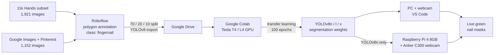

# Fingernail Segmentation & Tracking with YOLOv8

**Real-time fingernail instance segmentation using custom-trained YOLOv8 models (nano, large, extra-large), deployed on a PC and on a Raspberry Pi 4 with a USB webcam.**

Master's thesis: *Development & Testing of a Fingernail-Tracking System using a Neural Network*
(*Entwicklung & Test eines Fingernagelverfolgungssystems mittels Neuronalen Netzes*)

| | |
|---|---|
| **Author** | Rahul Planthottathukunnel Girijan |
| **Degree** | Master of Engineering (M.Eng.), Artificial Intelligence for Smart Sensors and Actuators |
| **Institution** | Deggendorf Institute of Technology (THD), Campus Cham, Faculty of Applied Natural Sciences and Industrial Engineering |
| **Supervisor** | Prof. Dr. Matthias Górka |
| **Submitted** | 12 July 2024 |

📄 The full thesis report is in [`docs/`](docs/).

---

## Table of Contents

- [Overview](#overview)
- [Key Results](#key-results)
- [Motivation](#motivation)
- [System Overview](#system-overview)
- [Dataset](#dataset)
- [Model: YOLOv8](#model-yolov8)
- [Training](#training)
- [Results](#results)
- [Real-Time Deployment](#real-time-deployment)
- [Robustness Tests](#robustness-tests)
- [Comparison with Benchmarks](#comparison-with-benchmarks)
- [Requirements Engineering](#requirements-engineering)
- [Hardware](#hardware)
- [Repository Structure](#repository-structure)
- [Getting Started](#getting-started)
- [Limitations](#limitations)
- [Future Work](#future-work)
- [Conclusion](#conclusion)
- [References](#references)
- [Acknowledgments](#acknowledgments)
- [Citation](#citation)

---

## Overview

Fingernails are useful as biometric identifiers and as indicators of health and lifestyle, with applications in health monitoring, biometric identification, drug verification and forensic science. Detecting them reliably is hard: nails vary widely in shape, size, colour and condition across people, and are affected by age, sex, ethnicity, nail polish, artificial nails and changing light.

This project trains **YOLOv8 instance-segmentation models** to find and outline every fingernail in an image, then runs them **live from a webcam** on a PC and on a low-cost **Raspberry Pi 4** prototype. Three model sizes (**YOLOv8n, YOLOv8l, YOLOv8x**) were trained on a hand-annotated dataset of **3,073 images** and compared on accuracy, speed, camera geometry, backgrounds and lighting.

**Keywords:** Fingernail Segmentation · Convolutional Neural Network (CNN) · Computer Vision · YOLOv8 · Raspberry Pi

## Key Results

| Model | mAP@0.50 | mAP@0.75 | mAP@0.50:0.95 | Best F1 (at conf.) | PC speed | FPS (PC) |
|---|---|---|---|---|---|---|
| **YOLOv8n** | 0.995 | 0.950 | 0.766 | 0.99 @ 0.546 | ~156 ms / frame | **6.54** |
| **YOLOv8l** | 0.995 | 0.971 | 0.780 | 0.99 @ 0.508 | ~1,220 ms / frame | 0.81 |
| **YOLOv8x** | **0.997** | **0.988** | **0.811** | 0.99 @ 0.629 | ~1,772 ms / frame | 0.56 |

- **YOLOv8x** is the most accurate model and beats the best published fingernail detectors (YOLOv4, Faster R-CNN) on mAP.
- **YOLOv8n** gives the best balance of speed and accuracy and is the recommended model for real-time use. It is also the only model run on the Raspberry Pi (~0.65 FPS).
- Optimal camera setup: **150 mm height at 90°** (working range 90–227 mm and 85°–125°).
- Reliable on white, black, blue and patterned wooden backgrounds; needs at least medium lighting.

---

## Motivation

- **Health:** changes in nail colour, growth and texture can signal conditions ranging from nutritional deficiencies to heart or liver disease.
- **Drug verification and doping control:** drug residues accumulate in nails over time.
- **Forensics:** nails can hold environmental residues useful in investigations.
- **Biometrics:** like fingerprints, nails have unique textures and patterns.

Classical methods (thresholding, edge detection, morphological operations, manual feature extraction) work only under stable lighting and backgrounds and cannot handle the variability of real nails. CNNs learn features directly from data and are more robust to changes in orientation, scale and lighting. YOLOv8 was chosen because it detects and segments multiple objects in a **single forward pass**, making it fast enough for real time.

**Aim:** build an effective fingernail-tracking system using a CNN, a well-annotated dataset, and a real-time segmentation model running on affordable hardware, and show that it can be commissioned for real-time use.

---

## System Overview



---

## Dataset

**3,073 high-resolution hand images**, one class: `fingernail`.

| Source | Images | Notes |
|---|---|---|
| [11K Hands](https://sites.google.com/view/11khands) (Afifi, 2019) | 1,921 | Subset of 11,076 images from 190 subjects aged 18–75. Palm (palmar) views, shaky captures and redundant frames were removed. |
| Google Images + Pinterest | 1,152 | Added to increase variety in nail shape and size, and especially nail polish and artificial nails. |
| **Total** | **3,073** | Different sexes, ages and ethnicities; includes polished, artificial and diseased or deformed nails. |

### Pre-processing

**11K Hands** (from the original dataset):
- 1600 × 1200 resolution, captured with a Point 2 View (P2V) USB document camera.
- Uniform white background to reduce background noise.
- Frames selected using SSIM between consecutive images to remove near-duplicates; blurry, cropped or oversaturated images discarded.
- Metadata per image: subject ID, gender, age, skin colour, left/right, dorsal/palmar, accessories, nail polish, irregularities.

**Web images** (added in this work):
- Random rotations and translations for hand orientation and position.
- Scaling and cropping for hand size and focus.
- Brightness, contrast and saturation changes to simulate different lighting.

### Annotation and Split

All 3,073 images were annotated **by hand by a single annotator** in **Roboflow** using the **polygon tool**, so each mask follows the real nail contour. Roboflow split and exported the data in YOLOv8 segmentation format:

| Split | Images | Share |
|---|---|---|
| Train | 2,155 | 70% |
| Validation | 611 | 20% |
| Test | 307 | 10% |

> **Dataset availability:** this repository contains the **labels and `data.yaml`** only. The raw images are not redistributed, because the 11K Hands licence restricts redistribution and the web images are third-party copyrighted content. See [`dataset/README.md`](dataset/README.md) for how to obtain the 11K Hands images.

---

## Model: YOLOv8

YOLOv8 (Ultralytics, January 2023) improves on earlier YOLO versions with:
- An anchor-free detection head and an enhanced backbone and neck for better feature extraction.
- CIoU loss for localisation, improved BCE loss for classification, and DFL (Distribution Focal Loss).
- Mosaic augmentation, switched off for the last 10 epochs.
- Fewer predicted boxes and faster NMS; supports quantisation and pruning for edge devices.

Three sizes of the **segmentation** variant were fine-tuned from COCO-pre-trained weights (transfer learning):

| Model | Depth multiple (d) | Width multiple (w) | Ratio (r) | Pre-trained weights |
|---|---|---|---|---|
| YOLOv8-n (nano) | 0.33 | 0.25 | 2.0 | `yolov8n-seg.pt` |
| YOLOv8-l (large) | 1.00 | 1.00 | 1.0 | `yolov8l-seg.pt` |
| YOLOv8-x (extra-large) | 1.00 | 1.25 | 1.0 | `yolov8x-seg.pt` |

For reference, the YOLOv8x-seg model has **401 layers, about 71 million parameters and about 345 GFLOPs**; 651 of 657 pre-trained weight tensors were transferred.

<details>
<summary><b>Background: evolution of YOLO (v1 → v8)</b></summary>

| Version | Year | Key ideas |
|---|---|---|
| YOLOv1 | 2016 | Single-pass detection as regression on a grid; 24 conv + 2 FC layers |
| YOLOv2 | 2017 | Batch norm, anchor boxes, multi-scale training; 78.6% AP on VOC2007 |
| YOLOv3 | 2018 | Multi-label logistic classifiers, k-means anchor priors; benchmark moved to MS COCO |
| YOLOv4 | 2020 | "Bag of freebies" and "bag of specials" |
| YOLOv5 | 2020 | Ultralytics, PyTorch implementation; 50.7% AP (YOLOv5x, 640 px) |
| YOLOv6 | 2022 | Anchor-free, industrial focus; YOLOv6-L 52.5% AP |
| YOLOv7 | 2022 | E-ELAN, model scaling, re-parameterisation |
| YOLOv8 | 2023 | Anchor-free head, new backbone, segmentation support; YOLOv8x 53.9% AP on COCO |

</details>

---

## Training

| Setting | Value |
|---|---|
| Framework | Ultralytics YOLOv8, PyTorch 2.3.0+cu121 |
| Platform | Google Colab (dataset and results on Google Drive) |
| GPU (YOLOv8n) | NVIDIA Tesla T4, 12 GB VRAM, 14.7 GB system RAM |
| GPU (YOLOv8l, YOLOv8x) | NVIDIA L4, 24 GB GDDR6 VRAM, Intel Xeon CPU, ~56.9 GB RAM, SSD |
| Epochs | 100 |
| Optimiser | Selected automatically by Ultralytics |
| Precision | Automatic Mixed Precision (AMP) |
| Augmentation | Ultralytics defaults (incl. mosaic, off for the last 10 epochs) |
| Training time (YOLOv8x) | 3.718 hours |

Training workflow (see [`notebooks/`](notebooks/)):

1. Mount Google Drive.
2. `pip install ultralytics` (brings in PyTorch, CUDA, NumPy, OpenCV, Matplotlib, Albumentations, Pandas).
3. Point `data.yaml` at the train, val and test folders (`nc: 1`, `names: ['fingernail']`).
4. Load `yolov8{n,l,x}-seg.pt` and call `model.train(data=..., epochs=100)`.
5. Validate and save results to `runs/`.
6. Set UTF-8 encoding and copy `runs/` back to Google Drive.

```python
from ultralytics import YOLO

model = YOLO("yolov8n-seg.pt")  # or yolov8l-seg.pt / yolov8x-seg.pt
model.train(data="dataset/data.yaml", epochs=100)
```

---

## Results

### Confusion Matrix (validation set)

| Model | True positives | False positives | False negatives |
|---|---|---|---|
| YOLOv8n | **3,028** | 31 | **19** |
| YOLOv8l | 3,023 | **30** | 24 |
| YOLOv8x | 3,024 | 31 | 23 |

- **YOLOv8n** has the most true positives and the fewest missed nails.
- **YOLOv8l** has the fewest false positives but misses slightly more nails.
- **YOLOv8x** sits between the two, close to YOLOv8n.

### Curves

| Metric | YOLOv8n | YOLOv8l | YOLOv8x |
|---|---|---|---|
| Precision reaches 1.00 at confidence | 0.916 | 0.943 | 0.927 |
| Best F1 score | 0.99 @ 0.546 | 0.99 @ 0.508 | 0.99 @ 0.629 |

- **Precision–Recall:** large area under the curve for both boxes and masks, identical across all three models.
- **Recall–Confidence:** recall approaches 1.0 at low confidence thresholds, the same for all models.
- **Training and validation losses** (box, segmentation, classification, DFL) decrease steadily, and validation losses follow training losses, so there is no sign of overfitting.
- **Precision, recall, mAP50 and mAP50-95** for boxes (B) and masks (M) rise steadily towards 1.0.
- **Validation batches:** most nails are detected with about 0.9 confidence (a few about 0.8), including partly occluded hands and nails that blend into the background.

Training and validation plots for each model are in [`results/`](results/).

---

## Real-Time Deployment

### On a PC (VS Code + webcam)

Two live scripts are provided:

| Script | What it does |
|---|---|
| [`src/live.py`](src/live.py) | `model.track(source=0, tracker="bytetrack.yaml")`: live tracking with ByteTrack; shows bounding boxes and masks. |
| [`src/run_yolo.py`](src/run_yolo.py) | Runs `model.predict()` on each OpenCV frame and paints the masks **green** with no bounding boxes. Press `q` to quit. |

**Measured speed on the PC (one frame):**

| Model | Pre-process | Inference | Post-process | Total | FPS |
|---|---|---|---|---|---|
| YOLOv8n | 2.4–3.7 ms | 136.4–136.9 ms | 7.2–15.2 ms | ~156 ms | **6.54** |
| YOLOv8l | – | – | – | ~1,220 ms | 0.81 |
| YOLOv8x | – | – | – | ~1,772 ms | 0.56 |

All three models produced near-identical masks on normal nails and on artificial nails with polish.

### On a Raspberry Pi 4 (YOLOv8n only)

1. Flash Raspberry Pi OS with Raspberry Pi Imager, then run `sudo apt-get update && sudo apt-get upgrade`.
2. Create and activate a virtual environment:
   ```bash
   python3 -m venv yolov8-env
   source yolov8-env/bin/activate
   pip install torch torchvision
   pip install opencv-python numpy ultralytics
   ```
3. Copy `Yolov8n.pt` and [`src/segmentation.py`](src/segmentation.py) to the Pi. This script is adapted for the Ultralytics version on the Pi: it converts BGR to RGB and resizes the mask to the frame.
4. Connect the webcam to a USB 3.0 port, mount it on the tripod, and run `python segmentation.py`.

| Stage | Time on Raspberry Pi |
|---|---|
| Pre-process | 6.1–12.1 ms |
| Inference | 1,100.4–1,499.1 ms |
| Post-process | 13.9–19.5 ms |
| **Total** | **~1,526 ms → ~0.65 FPS** |

The Pi detects all five nails but, because of the processing lag, only one mask is drawn at a time. Inference on the PC is roughly **4× faster**, because the Pi has no GPU and runs everything on its CPU.

---

## Robustness Tests

### Camera height and angle
Tested with a hand of 215 mm palm size:

| Parameter | Working range | Optimum |
|---|---|---|
| Height | 90 mm – 227 mm | **150 mm** (all 5 nails stay in frame) |
| Angle to the surface | 85° – 125° | **90°** (top-down) |

Below 85° the middle finger is lost; above 125° the thumb is lost.

### Backgrounds
Same camera and lighting, only the surface changed: **white, black, blue and a patterned wooden table**. Accuracy stayed high on all four.

### Lighting (YOLOv8n)

| Lighting | Result |
|---|---|
| Darkest | No detection; the camera's auto low-light correction could not capture enough detail. |
| Low | Only 2 nails detected, with poor masks and low confidence. |
| Medium | All 5 nails detected; small boundary errors (one nail split in two). |
| Good | All 5 nails detected and segmented accurately with high confidence. |

---

## Comparison with Benchmarks

Compared with the fingernail-detection study by Sunker et al. (ISAG 2021), which also used 11K Hands:

| Model | mAP@0.50 IoU | mAP@0.75 IoU | mAP |
|---|---|---|---|
| YOLOv4 | 0.997 | 0.968 | 0.776 |
| YOLOv4-Leaky | 0.858 | 0.506 | 0.472 |
| YOLOv4-Mish | 0.996 | 0.851 | 0.668 |
| Faster R-CNN | 0.989 | 0.942 | 0.747 |
| **YOLOv8n (this work)** | 0.995 | 0.950 | 0.766 |
| **YOLOv8l (this work)** | 0.995 | 0.971 | 0.780 |
| **YOLOv8x (this work)** | **0.997** | **0.988** | **0.811** |

YOLOv8x achieves the highest mAP of all models. YOLOv8n is close behind while being far faster, so it is the most practical choice for real-time nail detection.

---

## Requirements Engineering

The system was specified with a structured requirements-management process (literature review, case studies, comparative analysis).

**Functional requirements**
- Capture nails in lighting from very dark to very bright.
- Separate nails from skin and background, with mask tolerance ≤ 0.5 mm.
- Classify nail abnormalities (discolouration, ridges, deformations) with 95% accuracy (target).
- Process each image in under 2 s for live use.
- Detect and separate all 5–10 nails per frame.
- Work at heights of 10–50 cm and angles of 0°–180°, with 0.5 mm tolerance.

**Non-functional:** performance (< 2 s), scalability, usability for experts and the public, reliability, and security and confidentiality of nail images.

**Constraints:** cost-effective and portable hardware; compatible with smartphones and dedicated cameras; demographically broad training data.

**Priorities**
- **High:** accurate segmentation, real-time processing, robustness to lighting and background, YOLOv8, and multiple nails per image.
- **Medium:** scalability, a UI for non-experts, and abnormality classification.
- **Low:** domain-specific features (biometrics, forensics, healthcare, cosmetics) and customisation.

**Validation** was done by prototyping and testing with real photos and live video, measuring accuracy and processing time. Changes were tracked with a traceability matrix, change management and version-controlled documentation.

---

## Hardware

| Component | Details |
|---|---|
| **Raspberry Pi 4 Model B (8 GB)** | Broadcom BCM2711 quad-core Cortex-A72 (ARMv8) 64-bit @ 1.5 GHz; 8 GB LPDDR4-3200; 2× USB 3.0 and 2× USB 2.0; Gigabit Ethernet; dual-band Wi-Fi 802.11ac; Bluetooth 5.0/BLE; 2× micro-HDMI (4Kp60); 40-pin GPIO; case with cooling fan; 5 V/3 A USB-C power |
| **Anker PowerConf C300 webcam** | 1080p, 60 fps, autofocus, auto low-light correction, adjustable mount, USB-C |
| **Tripod stand** | Adjustable height and angle, adjustable centre column, 360° rotatable head with quick-release plate, non-slip feet |
| **Storage** | 64 GB SanDisk microSD |
| **Recommended additions** | Controlled LED lighting; an NVIDIA Jetson (e.g. Jetson Nano) for GPU-accelerated inference |

**Software:** Python, Ultralytics YOLOv8, PyTorch, OpenCV, NumPy, Roboflow, Google Colab, VS Code (PC), Thonny and Raspberry Pi OS (Pi).

---

## Repository Structure

```
fingernail-segmentation-yolov8/
├── README.md
├── requirements.txt
├── docs/                         # Thesis report (PDF)
├── notebooks/                    # Colab training notebooks
│   ├── Fingernail_segmentation_n.ipynb
│   ├── Fingernail_segmentation_l.ipynb
│   └── Fingernail_segmentation_x.ipynb
├── src/
│   ├── live.py                   # PC: live tracking with ByteTrack (boxes + masks)
│   ├── run_yolo.py               # PC: live green masks without boxes
│   ├── segmentation.py           # Raspberry Pi: live segmentation
│   └── train.py                  # Local training script (same setup as the notebooks)
├── models/                       # Yolov8n.pt (l and x in GitHub Releases)
├── results/                      # Training curves, confusion matrices, batches
└── dataset/
    ├── README.md                 # How to obtain the images
    ├── data.yaml
    ├── train/labels/
    ├── valid/labels/
    └── test/labels/
```

---

## Getting Started

```bash
git clone https://github.com/rahulpg33/fingernail-segmentation-yolov8.git
cd fingernail-segmentation-yolov8
python -m venv .venv
.venv\Scripts\activate             # Windows; on Linux/macOS: source .venv/bin/activate
pip install -r requirements.txt
```

**Live segmentation from your webcam:**
```bash
python src/run_yolo.py --model models/Yolov8n.pt   # green masks, press q to quit
python src/live.py --model models/Yolov8n.pt       # tracking with ByteTrack
```
`Yolov8n.pt` is included in `models/`. The larger `Yolov8l.pt` and `Yolov8x.pt` weights can be downloaded from the [Releases](https://github.com/rahulpg33/fingernail-segmentation-yolov8/releases) page.

**Inference on an image:**
```python
from ultralytics import YOLO
model = YOLO("models/Yolov8n.pt")
model.predict("hand.jpg", save=True)
```

**Retrain:** put the images next to the labels in `dataset/` (see `dataset/README.md`), then run one of the notebooks or:
```bash
python src/train.py --size n       # or l / x
```

---

## Limitations

- **Hardware:** the Raspberry Pi 4's CPU-only inference limits real-time performance, even for YOLOv8n (~0.65 FPS).
- **Model complexity:** YOLOv8x is the most accurate but too slow for real-time use on constrained devices.
- **Dataset size:** 3,073 images may not cover every nail shape, size and condition.
- **Speed vs. accuracy:** YOLOv8n trades a little precision for speed.
- **Deployment:** optimising for low-power devices and keeping performance consistent across hardware is non-trivial.
- **Precision:** more data and longer training should improve accuracy, but this was not tested empirically.
- **Camera geometry:** the optimal height and angle were measured on a single hand (215 mm palm size).
- **Benchmarks:** SSD and EfficientDet were not compared because of time constraints.

## Future Work

- A larger, more diverse dataset covering hand shapes, sizes, skin tones, artificial nails, polishes and lighting.
- Quantisation, distillation and pruning for microcontrollers and edge AI devices.
- An **NVIDIA Jetson Nano** or similar, to run larger models such as YOLOv8x without dropping frames.
- A controlled lighting rig as part of the setup.
- Applications: automatic manicure systems, nail-disease detection, AR virtual nail try-on.
- Long-term, real-world trials with user feedback.
- Privacy and ethics: secure storage, anonymised biometric data, informed consent.

## Conclusion

YOLOv8 is effective for real-time fingernail segmentation. **YOLOv8x** achieved the highest accuracy (mAP 0.811), surpassing YOLOv4 and Faster R-CNN, while **YOLOv8n** offered the best speed–accuracy balance for resource-constrained hardware such as the Raspberry Pi. The models were robust across plain and patterned backgrounds, and the work lays a foundation for automated fingernail analysis in health, biometrics and security.

---

## References

Key references (the full bibliography of 35 sources is in the thesis report):

- M. Afifi, "11K Hands: Gender recognition and biometric identification using a large dataset of hand images," *Multimedia Tools and Applications*, 78:20835–20854, 2019.
- E. Sunker, F. Kocaturk, B. Bayram, T. Bakirman, S. Yilmaz, "Fingernail detection with deep neural architecture," *ISAG 2021*.
- G. Jocher et al., *Ultralytics YOLOv8*, GitHub, 2023.
- J. Terven, D.-M. Cordova-Esparza, J.-A. Romero-Gonzalez, "A comprehensive review of YOLO architectures in computer vision: From YOLOv1 to YOLOv8 and YOLO-NAS," *MAKE*, 5(4), 2023.
- J. Redmon et al., "You Only Look Once: Unified, real-time object detection," *CVPR 2016*.
- K. He, G. Gkioxari, P. Dollár, R. Girshick, "Mask R-CNN," *ICCV 2017*.
- S. Ren, K. He, R. Girshick, J. Sun, "Faster R-CNN," *IEEE TPAMI*, 2017.
- S. Minaee et al., "Image segmentation using deep learning: A survey," 2020.

## Acknowledgments

Thanks to **Prof. Dr. Matthias Górka** for supervision and guidance, **Andreas Englmeier** (lab engineer) for technical support, and the Faculty of Applied Natural Sciences and Industrial Engineering at Deggendorf Institute of Technology for resources.

## Citation

```bibtex
@mastersthesis{girijan2024fingernail,
  author = {Planthottathukunnel Girijan, Rahul},
  title  = {Development \& Testing of a Fingernail-Tracking System using a Neural Network},
  school = {Deggendorf Institute of Technology},
  year   = {2024},
  address = {Cham, Germany},
  type   = {Master's thesis}
}
```

## Contact

**Rahul Planthottathukunnel Girijan** · rahulpg10@gmail.com
